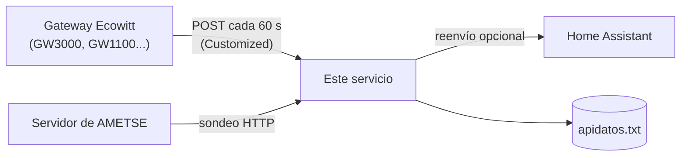

# 🌦️ Ecowitt → AMETSE

Pequeño servicio en Python que recibe los datos de tu estación **Ecowitt** y genera un fichero de texto `apidatos.txt` en el formato que usa **AMETSE** para recoger los datos de las estaciones de sus socios.


---

## ¿Qué hace?

Tu gateway Ecowitt envía sus lecturas a este servicio. El servicio las convierte a unidades métricas, guarda **una fila por minuto** en `apidatos.txt` (solo las últimas 24 horas) y lo publica en una URL para que AMETSE lo consulte periódicamente. Opcionalmente, reenvía los mismos datos a otros destinos como **Home Assistant**.



## Características

- Sin dependencias externas: solo librería estándar de Python (más `tzdata` para la zona horaria).
- Convierte unidades: °F → °C, mph → km/h, inHg → hPa, pulgadas → mm.
- Una fila por minuto, sin duplicados; si llega otra del mismo minuto, la sustituye.
- Retención configurable (por defecto 24 h) y escritura atómica del fichero.
- Ruta de subida configurable para que solo tú puedas escribir en el archivo.
- Reenvío opcional a Home Assistant u otros servicios (útil porque el gateway solo tiene **una** ranura *Customized*).
- Listo para desplegar con Docker, Coolify o cualquier otro orquestador.

## Formato del fichero

Una línea por lectura, con 11 campos entre comillas simples separados por `; ` y terminada en `;`:

```
'1792684560'; 'IMIESTACION01'; '22-10-2026 17:56'; '25'; '41'; '6'; '150'; '1010'; '0'; '9'; '150';
```

| # | Campo | Descripción | Unidad |
|---|-------|-------------|--------|
| 1 | `ts` | Marca de tiempo (segundos desde 1970, UTC), redondeada al minuto | s |
| 2 | `eid` | Identificador de la estación (empieza por `I`) | — |
| 3 | `Fecha` | Fecha y hora local, `dd-mm-aaaa HH:MM` | — |
| 4 | `outTemp` | Temperatura exterior | °C |
| 5 | `outHumidity` | Humedad exterior | % |
| 6 | `WindSpeed` | Velocidad del viento | km/h |
| 7 | `WindDir` | Dirección del viento | ° (0–360) |
| 8 | `Barometer` | Presión relativa (a nivel del mar) | hPa |
| 9 | `Rain10` | Lluvia **acumulada del día** | mm |
| 10 | `WindGust` | Racha de viento | km/h |
| 11 | `WindGustDir` | Dirección de la racha | ° |

> **Nota:** Ecowitt no proporciona la dirección de la racha, así que se usa la dirección del viento en ese momento.

> Este formato se ha deducido de un fichero de ejemplo y de lo que indicó AMETSE. Confírmalo con ellos antes de enviarles tu URL.

## Requisitos

- Un gateway o consola Ecowitt con la opción **Customized** en *Weather Services* (probado con GW3002 / GW3000).
- Un servidor con Docker (por ejemplo Coolify, Portainer o un simple `docker run`).
- Una URL accesible desde internet para que AMETSE pueda leer `apidatos.txt` (ver [Hacer accesible el fichero](#hacer-accesible-el-fichero)).

## Instalación

### Con Docker

```bash
docker build -t ecowitt-ametse .

docker run -d --name ecowitt-ametse \
  -p 8181:8080 \
  -v ecowitt-data:/data \
  -e STATION_ID=IMIESTACION01 \
  -e UPLOAD_PATH=/data/report/CAMBIA-ESTO-por-algo-largo-y-aleatorio \
  ecowitt-ametse
```

### Con Coolify

1. Sube el repositorio a GitHub (o cualquier Git) y crea una **Application** desde él.
2. **Build Pack:** `Dockerfile`.
3. **Ports Exposes:** `8080`.
4. **Ports Mappings:** `8181:8080` (elige un puerto libre en el host; si ves *"port is already allocated"*, cambia el de la izquierda).
5. **Environment Variables:** al menos `STATION_ID` y `UPLOAD_PATH` (ver tabla).
6. **Persistent Storage:** añade un **Volume Mount** con destino `/data`.
7. Despliega.

Comprueba que funciona: `http://IP-DEL-SERVIDOR:8181/health` debe responder `ok`.

## Configuración

Todo se configura con variables de entorno:

| Variable | Obligatoria | Por defecto | Descripción |
|----------|:-----------:|-------------|-------------|
| `STATION_ID` | ✅ | — | Identificador de tu estación (`eid`). Para AMETSE debe empezar por `I`. |
| `UPLOAD_PATH` | | `/data/report` | Ruta a la que el gateway envía los datos. **Usa una ruta larga y aleatoria.** |
| `FORWARD_URLS` | | *(vacío)* | URLs a las que reenviar los datos tal cual, separadas por comas. |
| `RAIN_FIELD` | | `dailyrainin` | Campo de Ecowitt usado para la columna de lluvia (`dailyrainin`, `hourlyrainin`, `rainratein`...). |
| `TIMEZONE` | | `Europe/Madrid` | Zona horaria para la columna `Fecha`. |
| `RETENTION_HOURS` | | `24` | Horas de datos que se conservan en el fichero. |
| `DATA_FILE` | | `/data/apidatos.txt` | Ubicación del fichero dentro del contenedor. |
| `PORT` | | `8080` | Puerto interno de escucha. |

## Configurar el gateway Ecowitt

En la app **WS View Plus**: *Weather Services → Customized*

| Ajuste | Valor |
|--------|-------|
| Protocolo | **Ecowitt** |
| Servidor | IP (o dominio) de tu servidor |
| Ruta | el valor de `UPLOAD_PATH` |
| Puerto | el puerto publicado (p. ej. `8181`) |
| Intervalo | `60` segundos |

> El envío personalizado del gateway funciona por **HTTP**, no HTTPS. Si tu servidor está en la misma red local, apunta a su IP local.

Los nombres exactos de los menús pueden variar según la versión de la app y del firmware.

### Presión relativa

Para que la presión sea comparable con otras estaciones, calibra la **presión relativa** del gateway hasta que coincida con la de una estación oficial cercana (por ejemplo, AEMET).

## Hacer accesible el fichero

AMETSE consulta una URL pública, por lo que `apidatos.txt` debe poder descargarse desde internet:

```
http://TU-DOMINIO:8181/apidatos.txt
```

Opciones habituales:

- **Redirección de puertos + DNS dinámico (DuckDNS, No-IP...)**: redirige el puerto público a tu servidor y usa tu dominio dinámico. No funciona si tu operador usa **CGNAT**.
- **Cloudflare Tunnel**: no abre puertos en el router y funciona con CGNAT. Necesita un dominio gestionado en Cloudflare.
- **FTP**: algunas asociaciones ofrecen un FTP donde subir el fichero en lugar de sondear tu URL.

Para probar la URL pública, hazlo **desde fuera de tu red** (por ejemplo, con los datos móviles del teléfono): muchos routers no permiten acceder a tu propia IP pública desde dentro.

## Reenviar a Home Assistant (u otros)

El gateway solo permite **un** servidor *Customized*. Si ya lo usas para Home Assistant, apunta el gateway a este servicio y configura el reenvío:

```
FORWARD_URLS=http://IP-DE-HOME-ASSISTANT:8123/api/webhook/TU_ID_DE_WEBHOOK
```

Se reenvía el `POST` original sin modificar, en segundo plano y con un tiempo máximo de 5 s. Un fallo en el destino no afecta a la generación del fichero. Puedes indicar varios destinos separados por comas.

> Mientras este servicio esté caído, Home Assistant tampoco recibirá datos. Si es un problema, valora consultar la API local del gateway en lugar del reenvío.

## Endpoints

| Método | Ruta | Descripción |
|--------|------|-------------|
| `POST` / `GET` | `UPLOAD_PATH` | Recibe los datos del gateway |
| `GET` | `/apidatos.txt` | Devuelve el fichero con las últimas lecturas |
| `GET` | `/health` | Comprobación de estado (`ok`) |
| `GET` | `/` | Texto informativo |

## Conversión de unidades

El protocolo Ecowitt envía siempre en unidades imperiales, independientemente de lo que muestres en la consola:

| Medida | Campo Ecowitt | Conversión |
|--------|---------------|------------|
| Temperatura | `tempf` | `(°F − 32) × 5/9` |
| Humedad | `humidity` | sin cambios |
| Viento / racha | `windspeedmph`, `windgustmph` | `mph × 1,609344` |
| Dirección | `winddir` | sin cambios |
| Presión | `baromrelin` (o `baromin`, `baromabsin`) | `inHg × 33,8639` |
| Lluvia | `dailyrainin` (configurable) | `in × 25,4` |

## Solución de problemas

**El despliegue falla con `port is already allocated`**
El puerto del host ya está en uso. Cambia el mapeo (por ejemplo, `8181:8080`) y vuelve a desplegar. Si es el contenedor anterior de esta misma app, páralo primero.

**Estado *Running* pero sin logs ni respuesta en `/health`**
Revisa que el Build Pack sea `Dockerfile`, que el mapeo de puertos esté definido y que `STATION_ID` exista (sin él la app se cierra al arrancar).

**No aparecen filas en `apidatos.txt`**
Mira los logs: deberías ver `Fila guardada` cada minuto. Comprueba la IP, el puerto y la ruta en el gateway. Si recibes `404`, la ruta no coincide con `UPLOAD_PATH`.

**Quiero empezar el fichero de cero**
Cambia `STATION_ID` si hace falta, redespliega y borra el archivo desde la terminal del contenedor: `rm /data/apidatos.txt`. Se regenera solo en el siguiente envío.

## Seguridad

- Usa una `UPLOAD_PATH` larga y aleatoria; es lo único que impide que otros escriban en tu fichero si el puerto está abierto a internet.
- Solo `/apidatos.txt` necesita ser público. No compartas la ruta de subida.
- El servicio no guarda ningún dato personal; solo las lecturas meteorológicas.

## Pruebas rápidas

Simula una subida del gateway:

```bash
curl -X POST \
  --data "tempf=68.5&humidity=55&windspeedmph=3.1&winddir=120&windgustmph=7.2&baromrelin=29.92&dailyrainin=0.1" \
  http://localhost:8181/data/report/TU_RUTA

curl http://localhost:8181/apidatos.txt
```

## Limitaciones

- No genera filas separadas de máximos y mínimos, solo las lecturas normales.
- Un solo formato de salida (el de sondeo de AMETSE); no cubre la plantilla de Meteoclimatic.
- La dirección de la racha es la del viento en ese instante.

## Licencia

Elige la que prefieras (por ejemplo, MIT) y añade un archivo `LICENSE` al repositorio.
